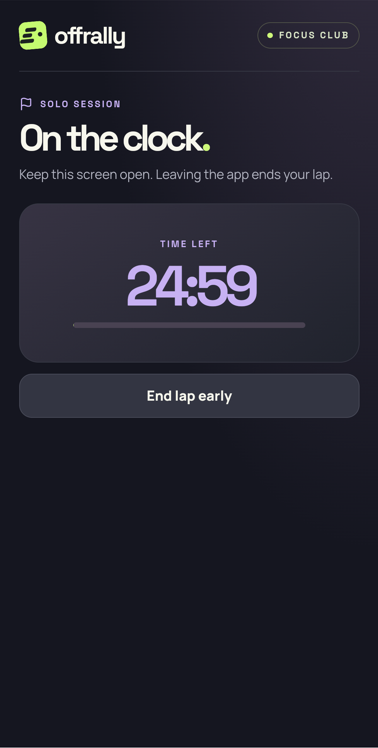

# Offrally

Pause the parts of your social apps that pull you back in. Open Instagram, Facebook, YouTube, Snapchat or TikTok from your home screen with the account you already use. Set the rules once in **Offrally → Protect**. Solo focus laps and private two-player duels are available on mobile and web.

**[Download Offrally 1.2 for Android](https://github.com/shiv-eshwar/offrally/releases/download/v1.2.0/Offrally-Android-1.2.apk)** · [iPhone Simulator build](https://github.com/shiv-eshwar/offrally/releases/download/v1.1.0/Offrally-simulator.zip) · [Open the web clubhouse](https://offrally.vercel.app)

| Platform | What protection does |
| --- | --- |
| Android | **Skip** covers recognized Instagram or Facebook Reels, YouTube Shorts, Snapchat Spotlight and TikTok For You tabs and intercepts taps on them. Opening a recognized viewer another way takes you to an available neighboring tab or back. **Pause entire app** puts a shield over the app with a Home button. Connect Accessibility and turn on protection to apply your rules. |
| iPhone and iPad, iOS 16+ | Connect Screen Time, pick individual apps in Apple's private picker, then enable protection. iOS displays a shield over each selected app. Apple's public controls operate at app level. Physical installs require an appropriately provisioned build. |
| Web | Use solo laps, history and friend duels. Device protection is a mobile feature. |

The Android 1.2 catalog also includes Reddit, X, Threads, Twitch, Pinterest and Discord for whole-app protection. **Add another installed app** lets you pause other apps that appear in your launcher, including preinstalled apps. Offrally, Home, accessibility settings and the system and default phone apps are excluded from the picker.

A covered tab leaves a blank space in its original position. Coverage depends on the publisher’s layout and language. Android may display a launch frame before it reports the foreground window. Native emulator fixtures exercise these paths. Signed-in publisher builds and a provisioned physical iPhone still require device verification.

## Offrally in action

| App protection on Android | iPhone clubhouse | Live friend duel |
| :---: | :---: | :---: |
|  |  |  |

| Android rule choices | Solo focus lap |
| :---: | :---: |
|  |  |

The protection screen is from the installed Android app using test apps on an emulator. The clubhouse is from iPhone Simulator. The duel shows two test players connected to the live scoring service.

## Focus with a friend

Open **Duels**, choose a nickname and a round length, then share the room code. The second player joins from their device. Each scores while their duel screen is open. Both see the same result when the round ends.

## Build and verification

Use Node 22+, run `npm ci`, `npm test` and `npm run sync`. Build Android with `cd android && ./gradlew :app:testDebugUnitTest :app:assembleDebug`. Open `ios/App/App.xcodeproj` in Xcode for iOS.

[Product](whatthis.md) · [Architecture](architecture.md) · [Engineering and release checks](engineering.md) · [Verification record](progress.md) · [Mobile build workflow](https://github.com/shiv-eshwar/offrally/actions/workflows/mobile.yml)
