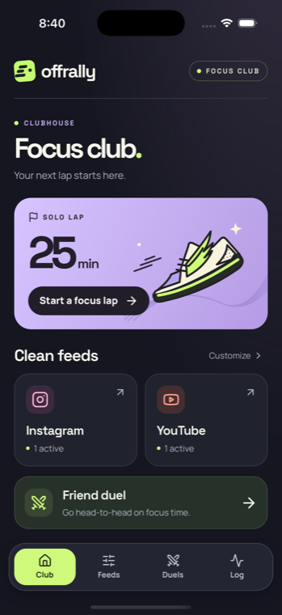
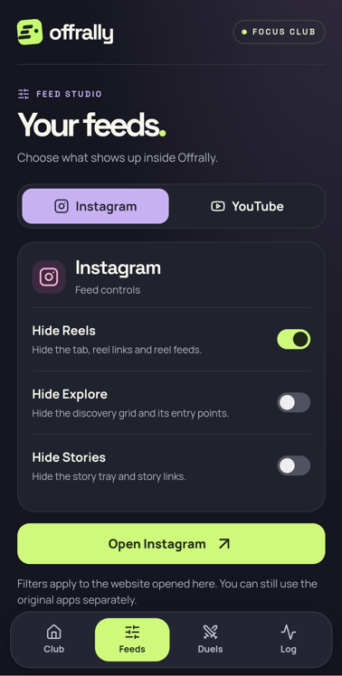
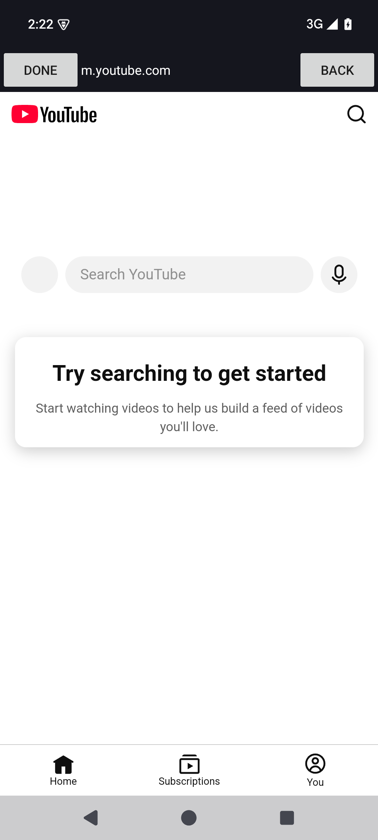

# Offrally

A pocket focus club for iOS and Android. Hide Instagram Reels and YouTube Shorts inside a protected browser, run solo focus laps, or challenge a friend to a timed duel.

**[Try Offrally on the web](https://offrally.vercel.app)** · **[Download the Android and iOS Simulator pilot builds](https://github.com/shiv-eshwar/offrally/releases/tag/v0.1.0-pilot)**

The web app supports solo laps and friend duels. Feed filtering runs inside the installed mobile apps.

## Offrally in action

| iPhone clubhouse | Instagram feed controls | Live friend duel |
| :---: | :---: | :---: |
|  |  |  |

| Solo lap in progress | YouTube with Shorts hidden |
| :---: | :---: |
|  |  |

Captured from the pilot running on iPhone Simulator and the Android emulator. The duel uses test players connected to the live service.

## Play with a friend

Choose **Duels**, enter a nickname, pick a round length and create a room. Share the invite code. Your friend opens **Join room** on their device. The round starts when the second player joins. Keep the duel screen open to score. Both players see the winner when time runs out.

## Use the mobile app

Open **Feeds**, select Instagram or YouTube and choose the sections to hide. Tap **Open Instagram** or **Open YouTube**. The original standalone apps continue to operate normally. **Done** returns to Offrally. The feed browser loads the provider directly. Accounts and cookies belong to the embedded browser.

## Build

    npm ci
    npm test
    npm run sync

For Android run `cd android && ./gradlew assembleDebug`. Install the debug APK on an Android device or emulator. For iOS open `ios/App/App.xcodeproj`, choose the App scheme and an iPhone simulator. Device installs require signing. GitHub Actions also builds downloadable Android and iOS simulator packages.

## Project notes

- [Product](whatthis.md)
- [Engineering and deployment](engineering.md)
- [Architecture and data boundaries](architecture.md)
- [Progress and verification](progress.md)
- [Mobile builds](https://github.com/shiv-eshwar/offrally/actions/workflows/mobile.yml)
