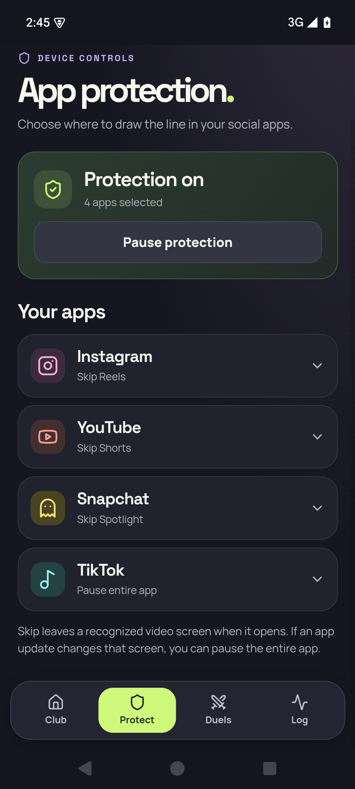
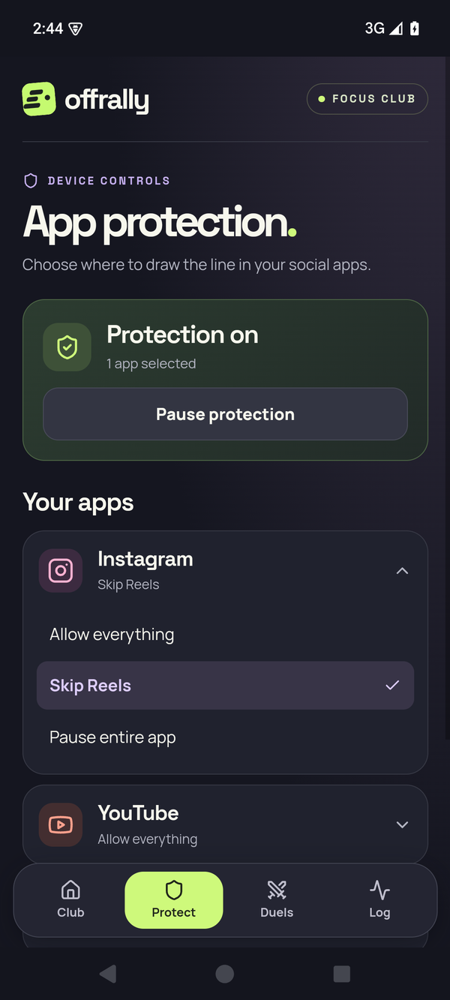

# Offrally

Pause the parts of your social apps that pull you back in. Open Instagram, YouTube, Snapchat or TikTok from your home screen with the account you already use. Set the rules once in **Offrally → Protect**. Solo focus laps and private two-player duels are available on mobile and web.

**[Download the Android test build and iPhone Simulator build](https://github.com/shiv-eshwar/offrally/releases/tag/v1.1.0)** · **[Open the web clubhouse](https://offrally.vercel.app)**

| Platform | What protection does |
| --- | --- |
| Android | Choose **Allow everything**, **Skip** the short-video section or **Pause entire app** for each supported app. Skip sends you back from a recognized Instagram Reels, YouTube Shorts, Snapchat Spotlight or TikTok For You screen. Pausing the whole app returns you to Android Home. Rules take effect after you connect Accessibility and turn on protection. |
| iPhone and iPad, iOS 16+ | Connect Screen Time, pick individual apps in Apple's private picker, then enable protection. iOS displays a shield over each selected app. Apple's public controls operate at app level. Physical installs require an appropriately provisioned build. |
| Web | Use solo laps, history and friend duels. Device protection is a mobile feature. |

Android section detection depends on the publisher's accessibility layout. The native tab stays visible. The release has been exercised on native emulator fixtures. Current signed-in publisher builds and a provisioned physical iPhone are outstanding release checks.

## Offrally in action

| App protection on Android | iPhone clubhouse | Live friend duel |
| :---: | :---: | :---: |
|  |  |  |

| Android rule choices | Solo focus lap |
| :---: | :---: |
|  |  |

The protection screen is from the installed Android app using test apps on an emulator. The clubhouse is from iPhone Simulator. The duel shows two test players connected to the live scoring service.

## Focus with a friend

Open **Duels**, choose a nickname and a round length, then share the room code. The second player joins from their device. Each scores while their duel screen is open. Both see the same result when the round ends.

## Build and verification

Use Node 22+, run `npm ci`, `npm test` and `npm run sync`. Build Android with `cd android && ./gradlew :app:testDebugUnitTest :app:assembleDebug`. Open `ios/App/App.xcodeproj` in Xcode for iOS.

[Product](whatthis.md) · [Architecture](architecture.md) · [Engineering and release checks](engineering.md) · [Verification record](progress.md) · [Mobile build workflow](https://github.com/shiv-eshwar/offrally/actions/workflows/mobile.yml)
